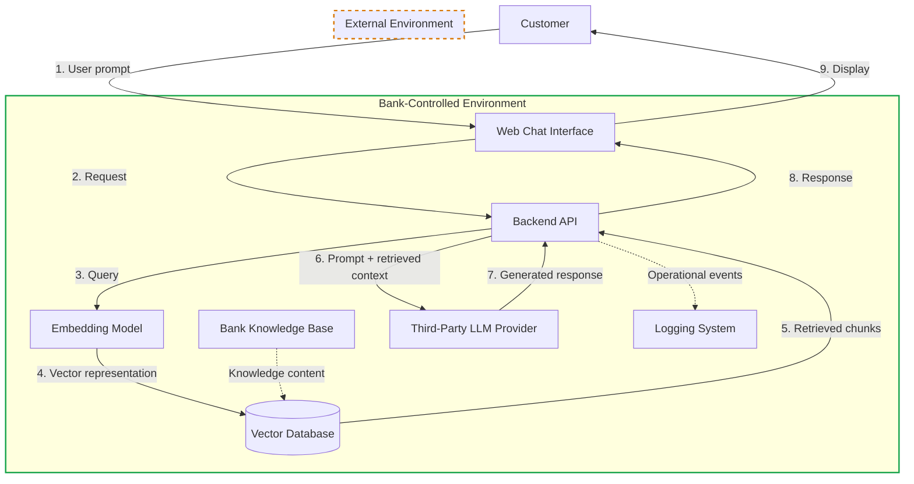

# Data Flow Analysis

## 1. Overview

This phase examines how data moves through the Meridian Bank AI Assistant, including interactions between the customer, application components, internal retrieval mechanisms and the external LLM provider.

The objective is to understand how information is processed, where data crosses security boundaries and which interactions may introduce security risks.

This analysis is based on the assumed architecture established during the System Definition phase.

---

## 2. Data Flow Description

### 2.1 User Request

The customer submits a question through the Web Chat Interface.

The submitted input may contain:

- Legitimate banking-related questions
- Unexpected or malformed input
- Prompt injection attempts
- Attempts to manipulate system instructions
- Requests for information outside the assistant's intended scope

<text color="secondary">Security consideration: User input is considered untrusted and must not be relied upon as safe based solely on client-side validation.</text>

### 2.2 Request Processing

The Backend API receives the request and orchestrates the processing workflow.

Its assumed responsibilities include:

- Receiving and handling user requests
- Initiating the retrieval process
- Preparing the context for LLM inference
- Sending requests to the external LLM
- Handling and returning generated responses

<text color="secondary">Security consideration: The backend represents a critical component because it mediates interactions between the user, internal retrieval components and the external LLM.</text>

### 2.3 Embedding Generation

The backend forwards the user query to the Embedding Model, which converts the text into a vector representation.

This representation is subsequently used to identify semantically relevant content within the Vector Database.

<text color="secondary">Security consideration: Query processing, model integrity and the handling of user-provided content require further evaluation.</text>

### 2.4 Knowledge Retrieval

The Vector Database is queried using the generated vector representation.

Relevant document chunks are retrieved from the bank's knowledge base and returned to the backend.

The knowledge base is assumed to contain bank-approved policies, FAQs and product documentation. However, document ingestion, validation, approval and update mechanisms have not yet been defined.

<text color="secondary">Security consideration: The integrity, authenticity and relevance of retrieved content are critical to the security and reliability of the assistant.</text>

### 2.5 Prompt Construction and LLM Interaction

The backend combines the original user query with retrieved content to construct the request sent to the Third-Party LLM Provider.

The external provider generates a response based on the submitted prompt and context.

<text color="secondary">Security consideration: User input and retrieved content may influence LLM behavior. Data transmitted to an external provider also introduces third-party data processing and exposure considerations.</text>

### 2.6 Response Handling

The LLM-generated response is returned to the backend.

The backend subsequently forwards the response to the Web Chat Interface, where it is displayed to the customer.

LLM-generated content is considered untrusted output and requires appropriate handling before being delivered to the client.

<text color="secondary">Security consideration: Response handling, output validation and potential downstream interpretation of generated content require further assessment.</text>

### 2.7 Logging

The Backend API is assumed to generate operational events that are sent to the Logging System.

The exact content of logs, access permissions, retention periods and whether user prompts or retrieved content are recorded remain undefined.

<text color="secondary">Security consideration: Logging may introduce risks related to sensitive data exposure, unauthorized access and excessive data retention.</text>

---

## 3. Data Flow Diagram

*Figure 1. Data Flow of the Meridian Bank AI Assistant*

---

## 4. Trust Boundaries

Trust boundaries identify transitions between entities or components with different trust assumptions.

### TB-01 — Customer / Client to Bank Application

**Boundary:** Customer and client-side interface to the bank-controlled application.

**Data crossing the boundary:** User prompts and request-related data.

**Trust assumption:** User input is untrusted.

**Security implications:**

- Prompt injection and instruction manipulation
- Input validation and sanitization
- Abuse and automated request submission
- Unexpected input formats
- Application-level request manipulation

### TB-02 — Backend to RAG Components

**Boundary:** Backend API to internal retrieval components, including the Embedding Model and Vector Database.

**Data crossing the boundary:** User queries, vector representations and retrieved document chunks.

**Trust assumption:** Internal components should not automatically be trusted solely because they operate within the same assumed environment.

**Security implications:**

- Unauthorized component access
- Weak service-level authorization
- Insecure internal communication
- Retrieval data integrity
- Unauthorized access to stored knowledge

<text color="secondary">This is currently modeled as a logical component boundary rather than a confirmed network or infrastructure boundary.</text>

### TB-03 — Bank Environment to Third-Party LLM

**Boundary:** Bank-controlled application environment to the external LLM provider.

**Data crossing the boundary:** User prompts and retrieved contextual information.

**Trust assumption:** The external LLM provider operates outside the bank-controlled environment.

**Security implications:**

- Exposure of sensitive or confidential data
- Third-party data processing
- Provider retention policies
- Data residency and compliance requirements
- External service availability and dependency risks

---

## 5. Data Classification Considerations

The data involved in the system requires classification before security controls can be properly evaluated.

| Data | Source | Security Consideration |
|---|---|---|
| User prompts | Customer | May contain sensitive or personally identifiable information |
| Query embeddings | Embedding Model | May encode information derived from user input |
| Retrieved document chunks | Knowledge Base | May contain confidential internal or banking information |
| LLM request payload | Backend | May combine user input and retrieved content |
| LLM-generated response | Third-Party LLM | May contain inaccurate, manipulated or inappropriate information |
| Operational logs | Backend | May unintentionally capture sensitive information |

<text color="secondary">Actual data classification and sensitivity levels have not yet been established. These entries represent potential data types requiring further investigation.</text>

---

## 6. Preliminary Security Observations

The data flow analysis highlights several areas requiring further investigation during subsequent assessment phases.

| Observation | Area for Further Investigation |
|---|---|
| User input enters the application as untrusted data | Input handling and prompt injection defenses |
| Retrieved content influences LLM responses | Knowledge base integrity and retrieval security |
| User queries and retrieved content are sent to an external provider | Data protection and third-party security |
| Internal components exchange data | Internal access controls and communication security |
| Generated responses are returned to users | Output handling and response validation |
| Operational logging is assumed | Sensitive data exposure and log access controls |
| Knowledge ingestion procedures are undefined | Content validation, authorization and integrity |

---

## 7. Conclusion

The data flow analysis establishes the primary interactions between the customer-facing interface, backend services, retrieval components, knowledge base, logging system and external LLM provider.

Three primary trust boundaries have been identified: the client-to-application boundary, the internal backend-to-RAG component boundary and the bank-to-external-LLM boundary.

These boundaries and data interactions provide the foundation for the subsequent Asset & Attack Surface Analysis and Threat Identification phases.

