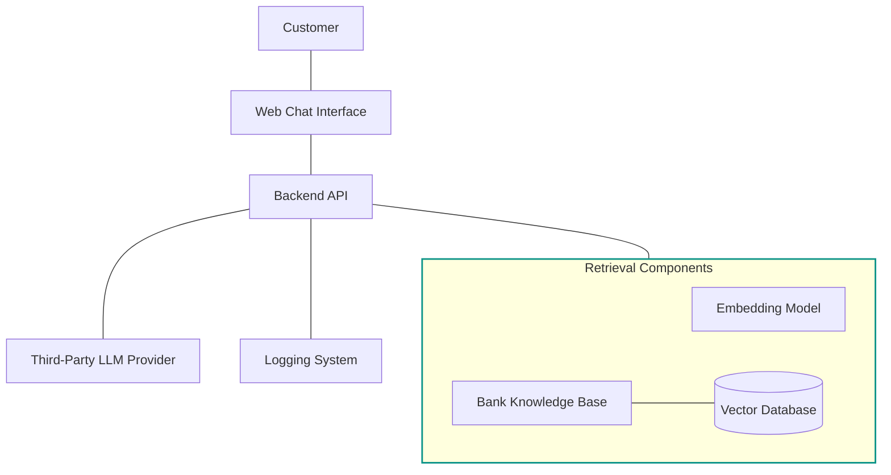

# System Definition & Architecture

## 1. System Overview

Meridian Bank plans to introduce an AI-powered assistant through its web application to help customers access information about banking products, card services, account procedures and frequently asked questions.

The assistant is designed to provide conversational responses by retrieving relevant information from the bank's knowledge base and using a Large Language Model (LLM) to generate answers.

The system follows a Retrieval-Augmented Generation (RAG) architecture, combining information retrieval with LLM-based response generation.

## 2. Intended Functionality

The AI assistant is intended to:

- Answer general questions about banking products and services
- Provide information about card services and account procedures
- Retrieve relevant content from bank-approved documentation
- Generate natural language responses based on retrieved information

The assistant is designed as an information-only service and is not intended to perform banking operations on behalf of customers.

## 3. System Scope

### In Scope

- Customer-facing web chat interface
- Backend request handling and orchestration
- Query embedding generation
- Vector-based knowledge retrieval
- Bank knowledge base
- Third-party LLM integration
- Response handling
- Operational logging

### Out of Scope

- Financial transaction execution
- Direct integration with core banking systems
- Customer document uploads
- Account modification or management operations

## 4. Architecture Components

| Component | Description |
|---|---|
| **Web Chat Interface** | Customer-facing interface through which users interact with the assistant |
| **Backend API** | Handles incoming requests and coordinates interactions between system components |
| **Embedding Model** | Converts text queries into vector representations for semantic retrieval |
| **Vector Database** | Stores vector representations and supports similarity-based retrieval |
| **Bank Knowledge Base** | Contains bank-approved policies, FAQs and product documentation |
| **Third-Party LLM Provider** | Generates responses using the submitted prompt and retrieved context |
| **Logging System** | Records operational events for monitoring and troubleshooting |

## 5. Architecture Baseline

The system is assumed to operate using the following architecture:

*Figure 1. High-level architecture of the AI Banking Assistant.*

## 6. Architecture Decisions & Assumptions

| ID | Decision / Assumption | Rationale |
|---|---|---|
| AD-01 | RAG architecture is used | Enables the assistant to retrieve relevant information from an external knowledge source without requiring model retraining for every content update |
| AD-02 | A third-party hosted LLM is used | The system relies on an externally provided LLM for response generation |
| AD-03 | The assistant is information-only | Reduces the initial scope by excluding transactional and account-management functionality |
| AD-04 | The knowledge base contains bank-approved content | Responses are intended to be grounded in approved banking documentation |
| AD-05 | Operational logging is implemented | Assumed to support monitoring and troubleshooting |
| AD-06 | The assistant is accessible through the bank's web application | Establishes the primary customer-facing interface |
| AD-07 | Authentication is not required for access to general information | Working assumption for the initial system design |

### Unresolved Architectural Assumptions

The following areas have not yet been defined:

- Knowledge base document ingestion and approval workflows
- Access controls for internal components
- Logging content, permissions and retention
- Third-party LLM data retention and processing policies
- Input validation and output handling mechanisms
- Security monitoring and abuse prevention mechanisms

These areas will be examined during subsequent assessment phases.

## 7. Assessment Objectives

The security assessment aims to:

- Identify critical assets and attack surfaces
- Examine trust boundaries and data flows
- Identify AI-specific and conventional security threats
- Develop relevant threat scenarios
- Evaluate and prioritize security risks
- Recommend security controls and mitigation strategies

